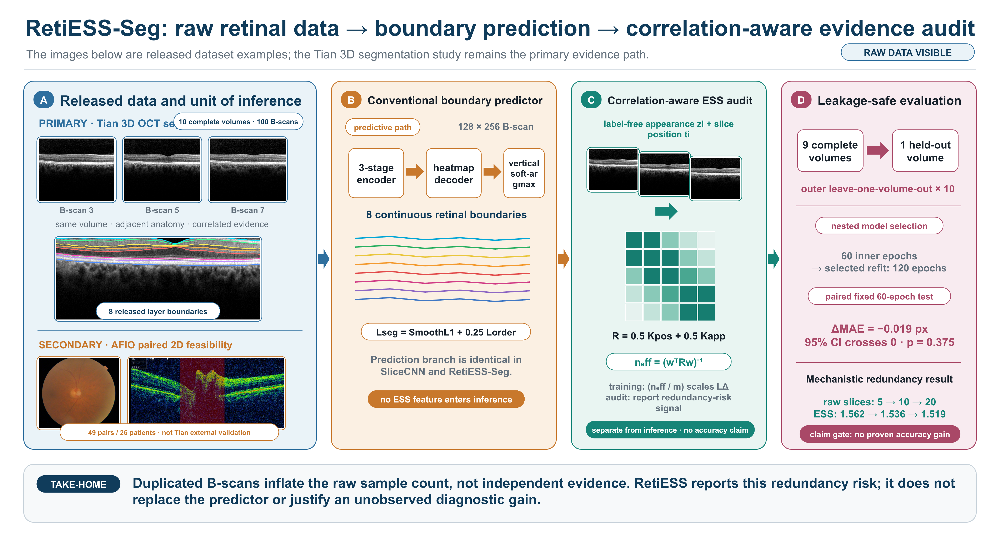

# RetiESS-Seg

Correlation-aware effective sample size auditing for small-sample three-dimensional retinal optical coherence tomography layer segmentation.

This repository accompanies the conference manuscript **“RetiESS-Seg: Correlation-Aware Effective Sample Size Auditing for Small-Sample 3D Retinal OCT Layer Segmentation.”** It contains the submitted paper artifacts, the core experiment code, the paper-facing figures, and the verified fold-level result files. Raw datasets and cached model features are intentionally excluded.



## Scientific scope

RetiESS combines slice position and label-free appearance similarity in a positive-semidefinite correlation matrix. The resulting effective sample size (ESS) is used as a redundancy audit and scales only the cross-slice derivative term during training. The predictor remains unchanged.

The paper makes a bounded claim:

- Exact duplication increases the nominal B-scan count without creating independent evidence.
- In the fixed 60-epoch paired comparison, RetiESS-Seg did **not** significantly improve boundary mean absolute error (MAE).
- The nested selection-and-refit experiment is reported separately and does not isolate augmentation from the longer refit budget.
- The Armed Forces Institute of Ophthalmology (AFIO) experiment is an exploratory two-dimensional multimodal extension, not external validation of Tian three-dimensional segmentation.

## Repository contents

- `paper/` — final DOCX, rendered PDF, editable framework PPTX, and equation sources.
- `src/` — Tian volume-level segmentation, RetiESS, nested selection, AFIO patient-disjoint evaluation, and figure scripts.
- `results/` — verified CSV and JSON outputs used in the manuscript.
- `figures/` — paper-facing PNG and SVG figures.
- `tests/` — focused RetiESS unit tests.

## Main verified results

| Analysis | Result | Interpretation |
|---|---:|---|
| SliceCNN, fixed 60 epochs | 11.450 ± 4.632 px | Paired reference |
| RetiESS-Seg, fixed 60 epochs | 11.431 ± 4.608 px | Difference −0.019 px |
| Bootstrap 95% CI | [−0.074, 0.028] px | Includes zero |
| Wilcoxon signed-rank test | p = 0.375 | No accuracy-superiority claim |
| Original 10 B-scans | ESS 1.536 ± 0.064 | Correlated baseline |
| Duplicate all to 20 B-scans | ESS 1.519 ± 0.063 | Copies remain redundant |
| Nested three-seed outer mean | 5.936 px; seed SD 0.162 | Selection-and-refit estimate; not an isolated augmentation effect |
| AFIO fusion | Balanced accuracy 0.542 ± 0.032; macro F1 0.485 ± 0.021 | Exploratory feasibility only |

## Data

Only complete, directly downloadable public releases were used. Download the datasets from their original sources; do not commit them to this repository.

- Tian OCTRIMA supporting data: <https://doi.org/10.1371/journal.pone.0133908.s002>
- AFIO paired OCT–fundus data: <https://doi.org/10.17632/2rnnz5nz74.2>

Expected local layout:

```text
data/
├── tian_octrima/extracted/FiletoShareforPONE/Subject1.mat ... Subject10.mat
└── afio_glaucoma/extracted/...
```

The Tian loader refuses partial releases: all ten volumes and their required annotation fields must be present.

## Environment

```bash
python -m venv .venv
source .venv/bin/activate
python -m pip install -r requirements.txt
export PYTHONPATH="$PWD/src"
```

No gated retinal model weights are required. AFIO feature caching uses the directly downloadable ImageNet-1K ResNet-18 weights provided by `torchvision`.

## Reproduce the primary Tian experiment

Fixed 60-epoch leave-one-volume-out comparison:

```bash
python src/run_tian_loo.py \
  --data-root data/tian_octrima/extracted/FiletoShareforPONE \
  --output results/reproduced_tian_loo_60e \
  --epochs 60 \
  --seed 20260831
```

Leakage-safe nested selection and 120-epoch selected-candidate refit:

```bash
python src/run_tian_nested_selection.py \
  --data-root data/tian_octrima/extracted/FiletoShareforPONE \
  --output results/reproduced_tian_nested \
  --inner-epochs 60 \
  --outer-epochs 120 \
  --seed 20260831
```

Volume-level statistics and perturbation audit:

```bash
python src/analyze_tian_results.py \
  --data-root data/tian_octrima/extracted/FiletoShareforPONE \
  --results results/reproduced_tian_loo_60e
```

## Reproduce the exploratory AFIO extension

After downloading and preparing the complete 49-pair archive:

```bash
python src/prepare_afio.py
python src/cache_afio_features.py --help
python src/run_afio_groupcv.py \
  --features features/afio_resnet18_complete.pt \
  --output results/reproduced_afio_groupcv \
  --epochs 300 \
  --seed 20260831
```

The split unit is the patient, never the individual image.

## Tests

```bash
PYTHONPATH=src python -m unittest discover -s tests -v
```

## Important interpretation boundary

RetiESS is an evidence-redundancy statistic and loss-scaling primitive. It is not a calibrated confidence score, referral score, disease probability, or substitute for external pathological validation.
